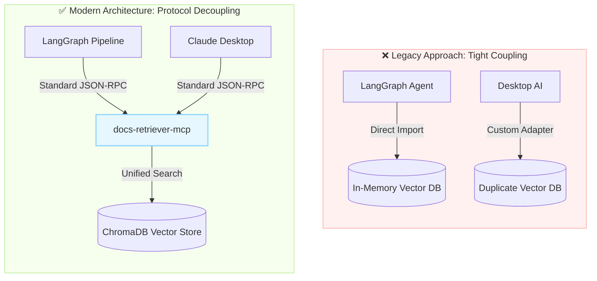
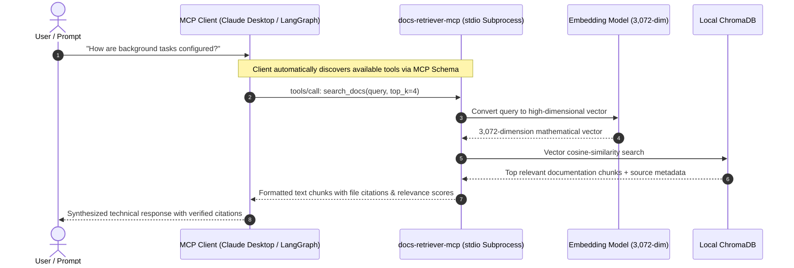
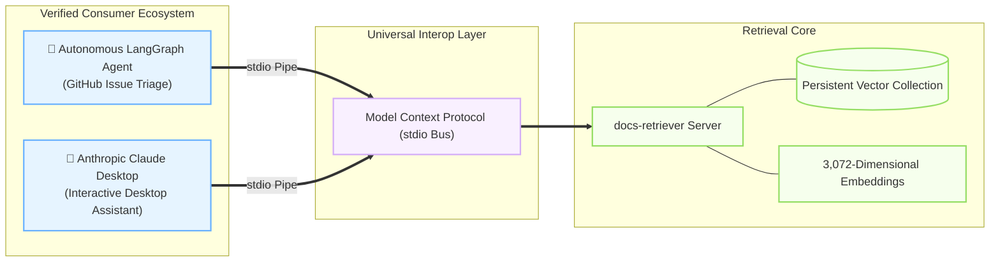

# ⚡ docs-retriever-mcp
### *Universal Model Context Protocol Service for Dynamic Semantic Retrieval*

[-blueviolet?style=for-the-badge)](https://modelcontextprotocol.io)
[-blue?style=for-the-badge)](#)

  <b>A decoupled, plug-and-play documentation intelligence engine.</b> 
  Built on the open Model Context Protocol standard to deliver instantaneous vector search across multiple AI workflows without framework lock-in or client-side database overhead.

---

## 🌐 The Problem: Monolithic Lock-In vs. Universal MCP

Traditional Retrieval-Augmented Generation (RAG) tightly couples database dependencies directly into agent application code. This architecture causes environment bloat, fragile dependencies, and forces developers to rewrite integration logic for every new AI interface.

`docs-retriever-mcp` extracts retrieval into an independent, protocol-driven microservice. Any AI client speaking the open MCP standard can discover, inspect, and invoke documentation retrieval dynamically.

---

## 🏛️ System Architecture & Data Flow

The server operates over standard I/O (`stdio`), acting as an on-demand process managed directly by client applications. There are zero open network ports, zero firewall hurdles, and zero authentication servers required for local execution.

---

## ✨ Key Architectural Innovations

### 1. Multi-Client Portability

* Verified across autonomous multi-step reasoning agents (LangGraph issue triage pipeline).
* Verified across off-the-shelf consumer applications (Anthropic's Claude Desktop).
* **Zero code modifications** needed on the server to switch or add consuming AI clients.

### 2. Client Dependency Elimination

* AI agents no longer carry heavy vector database libraries or embedding dependencies.
* Consuming agent packages remain ultra-lightweight, calling retrieval over standard text pipes.

### 3. Protocol Safety & Intent Contracts

* Incorporates tool execution annotations informing consuming LLMs of operational safety:
* **Read-Only Guarantee:** Guarantees no persistent state modification on execution.
* **Non-Destructive Execution:** Signals safe invocation without side effects.
* **Idempotency:** Guarantees identical parameters yield consistent results.

### 4. Resilient Boundary Defense

* Enforces strict validation parameters to eliminate blank queries and out-of-bounds requests.
* Isolated diagnostic telemetry prevents protocol stream corruption, ensuring seamless tool discovery.

---

## 🧭 Live Client Topology

---

## 📊 Core Tool Capabilities

| Capability | Specification | Architectural Role |
| --- | --- | --- |
| **Tool Name** | `search_docs` | Primary entry point for natural language document discovery. |
| **Input Constraints** | Bounded queries & parameter thresholds | Prevents malformed database operations before execution. |
| **Metadata Extraction** | Sources, file paths, and relative scores | Enables conversational LLMs to generate accurate technical citations. |
| **Execution Transport** | Standard Input / Output (`stdio`) | Subprocess lifecycle binding without networking overhead. |
| **Protocol Compliance** | MCP v2 Stateless Architecture | Self-describing requests via modern metadata standards. |

---

## 📈 Quality & Reliability Standards

The retrieval engine undergoes automated end-to-end evaluation to guarantee reliability across edge cases and high-concurrency requests:

* **Semantic Precision:** Evaluated against technical topics including authentication scopes, dependency injection, and middleware.
* **Citation Integrity:** Document chunks return exact source file names and relevance scores.
* **Defensive Edge Defense:** Rejects empty queries, whitespace inputs, and invalid limits with non-crashing structured responses.
* **Deterministic Execution:** Sub-second retrieval latency across local vector indices.

---

## 🔍 Verified Proof of Portability

> *"Anthropic's Claude Desktop discovering and executing retrieval against local vector documentation through `docs-retriever-mcp` with zero custom server modifications."*

---

